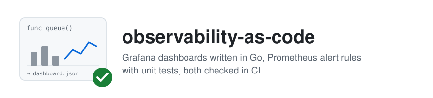
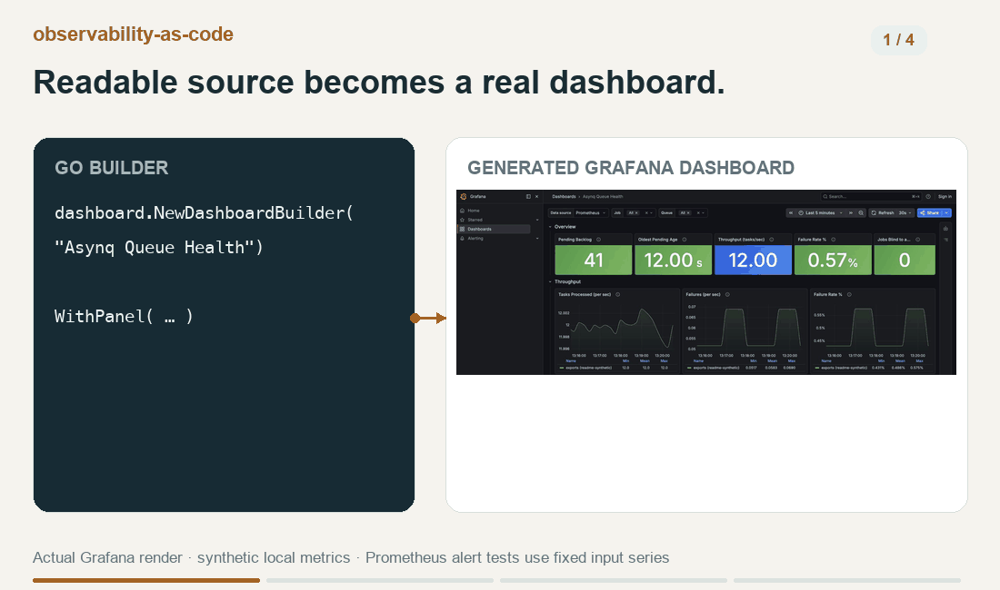

<picture>
  <source media="(prefers-color-scheme: dark)" srcset=".github/assets/banner-dark.svg">
  
</picture>

[](https://github.com/tetriz-ai/observability-as-code/actions/workflows/ci.yml)
[](LICENSE)
[](go.mod)

<a href="https://www.producthunt.com/products/agentic-workflow-kit?embed=true&amp;utm_source=badge-featured&amp;utm_medium=badge&amp;utm_campaign=badge-tetriz-engineering-kit" target="_blank" rel="noopener noreferrer"></a>

For a team that keeps Grafana dashboards and Prometheus alerts in git, a dashboard edited as JSON
gives a reviewer nothing to read, and an alert nobody has tested may never fire when it should.
Clone this repository, and a dashboard or alert change arrives as a readable diff that lint and
promtool tests have already checked. The example dashboards and alerts cover asynq queues,
go-redis commands, Kubernetes containers and gRPC servers, for you to keep or replace.



Readable source, a generated Grafana dashboard, and alert tests that catch a broken threshold. [Demo details](.github/assets/demo/README.md).

Releases are git tags. The first is v0.1.0. Read
[Versioning and compatibility](#versioning-and-compatibility) before you take one.

## Contents

- [What it does](#what-it-does) covers the example dashboards and alerts, and what is out of scope.
- [How it ships](#how-it-ships) says what you get when you clone it.
- [Quick start](#quick-start) generates the dashboards, runs `make test` and points at a test catching a broken alert.
- [Choosing a command](#choosing-a-command) maps what you have to the `make` target for it.
- [Usage](#usage) shows each target with a runnable example.
- [Reference](#reference) gives the exact targets, checks, metrics and alerts.
- [Before you rely on it](#before-you-rely-on-it) lists the limits the tests pin.
- [Project](#project) covers versioning, contributing and the license.

## What it does

It turns Go builders into Grafana JSON, lints dashboards and alert rules, unit-tests each alert
with promtool, and imports each dashboard into an empty Grafana, locally and in CI.

Each example set is tested, but only against the Grafana and Prometheus versions in
[Tools](#tools-and-the-versions-ci-pins).

| Example set | What it watches | What your service needs |
|---|---|---|
| asynq queues: `dashboards/asynq.go`, `alerts/rules-asynq.yaml` | Backlog, oldest pending age, throughput, failure share and paused queues, per job and queue. Seven alerts, among them a queue with work and no worker for 30 minutes | asynq's `x/metrics` queue collector, registered in one scraped job per Redis, as [two jobs, one Redis](#when-two-jobs-export-the-same-redis) explains. If you do not run asynq, delete `alerts/rules-asynq.yaml` and its test in `alerts/tests/`. |
| Redis commands: `dashboards/redis.go` | Command latency, rate and errors per client and per command, pipelined commands included | The `redis_single_*` and `redis_pipelined_*` metrics of the go-redis-prometheus hook, github.com/globocom/go-redis-prometheus. Under `honor_labels: true`, see [no per-client split](#when-the-redis-dashboard-shows-no-per-client-split). |
| Kubernetes and gRPC: `alerts/rules-platform.yaml` | Restart loops, OOM kills, memory near the container limit, slow gRPC methods with real traffic | kube-state-metrics, cAdvisor's container metrics from the kubelet, and go-grpc-prometheus's `grpc_server_handling_seconds` histogram, which that library emits only after you call `EnableHandlingTimeHistogram`. Custom buckets need a 2.5s bucket. |

### What it does not do

- It does not deploy. Grafana loads the generated files through provisioning, and
  prometheus-operator loads the rule files, which are PrometheusRule resources. Without the
  operator, write each file's `spec` to a plain rule file, such as
  `yq '.spec' alerts/rules-asynq.yaml > rules-asynq.yaml`, and list it under `rule_files`.
- It does not instrument your service. The example dashboards and alerts read metrics that
  existing libraries export.
- It does not check that a metric exists in your Prometheus. Lint and tests run offline, on the
  files alone.
- It does not ship the community dashboards themselves. Each is published on grafana.com under
  its author's terms.

## How it ships

Everything ships as source: there are no prebuilt binaries and no published packages, and
releases are git tags. Start with `git clone` rather than GitHub's "Use this template", whose copy
has its own history, so `git merge <tag>` can bring in a later release. Keep the example
dashboards and alerts you want, and run the generator, lint and tests with `make`.

## Quick start

You need Go 1.23 or newer, git and make, on Linux or macOS.

```sh
git clone https://github.com/tetriz-ai/observability-as-code
cd observability-as-code
make dashboards
```

```text
wrote dashboards/output/asynq-queue-health.json
wrote dashboards/output/redis-command-health.json
no community dashboards in dashboards/external/ (make dashboards-sync fetches them)
```

`make test` also needs promtool, yq v4, jq and `dashboard-linter` v0.3.0 on `PATH`. Run
`make install-tools`, then add `~/.local/bin` to `PATH`. Its downloads are Linux x86-64 only: on
macOS run `brew install prometheus yq jq`, then `make install-tools TOOLS=dashboard-linter`, which
needs Go 1.26.3 or newer.

```sh
make test
```

```text
Testing alert rules...
  SUCCESS

  SUCCESS

ok   Go tests
ok   alert gate tests
ok   dashboard gate tests
ok   sync script tests
ok   metric-name extraction tests
ok   CI installer tests
ok   Docker target tests
```

[catch-a-broken-alert](examples/catch-a-broken-alert/README.md) shows the rule test catching a
5% threshold typed as `0.5`, with the FAILED block it prints.

## Choosing a command

| You have | Run | Runnable example |
|---|---|---|
| A dashboard to change | [`make dashboards`](#generate-dashboards) | [generate-dashboards](examples/generate-dashboards/) |
| A dashboard to check before review | [`make lint-dashboards`](#lint-dashboards) | [catch-a-broken-dashboard](examples/catch-a-broken-dashboard/) |
| An alert rule to change | [`make lint-alerts test-alerts`](#lint-and-test-alert-rules) | [test-alert-rules](examples/test-alert-rules/) |
| Your own severities and routing label | [`make lint-alerts` with `ALERT_SEVERITIES` and `ALERT_ROUTING_LABEL`](#use-your-own-alert-labels) | [use-your-own-alert-labels](examples/use-your-own-alert-labels/) |
| A new alert rule | [a rule file, its test and `make check`](#add-an-alert-rule) | [add-an-alert-rule](examples/add-an-alert-rule/) |
| A new dashboard | [a Go file, one line in `dashboards()` and `make check`](#add-a-dashboard) | [add-a-dashboard](examples/add-a-dashboard/) |
| A community dashboard on grafana.com | [`make dashboards-sync`](#fetch-community-dashboards) | |
| Generated dashboards to look at | [`make dev-monitoring`](#preview-locally) | |
| Pull requests to gate | [`make check` and `make acceptance`](#gate-pull-requests) | |

Every target runs from the clone with no account or credential, and exits non-zero when a check
fails. `make help`, the default, lists them all.

## Usage

### Generate dashboards

```sh
make dashboards
```

It runs `go run ./dashboards -output <dir> -clean`, which first removes only the files it generated
there before, as `<dir>/.generated` lists them, so a removed dashboard's file does not linger for
provisioning to load. Other files in the directory are left alone. Set `DASHBOARDS_OUT=<dir>` for a
different output directory.

- An output path with a symbolic link in it, such as one under macOS's `/tmp`, is refused before
  anything is removed or written. Pass its resolved path, from `pwd -P`.
- `dashboards/output/`, `.generated` included, is in `.gitignore`, so it is not committed. Point Grafana's provisioning at
  it, or, if you deploy from git, delete its line from `.gitignore` and commit it.
- Files are written readable by every user, so a Grafana container can read them from a mounted
  directory.

### Lint dashboards

```sh
make lint-dashboards
```

- Exclusions live in `.dashboard-linter.yaml`, each with its reason. The example dashboards
  exclude only the instance rules, because their panels aggregate across instances.

### Lint and test alert rules

```sh
make lint-alerts test-alerts
```

- The tests repeat each alert's message word for word in their expected annotations, so editing a
  message means editing its test.

### Use your own alert labels

Set `ALERT_SEVERITIES` and `ALERT_ROUTING_LABEL`, which [`make lint-alerts`](#make-lint-alerts)
checks every alert against. The runnable example rejects a rule under the defaults, then passes
it with `ALERT_SEVERITIES="critical warning" ALERT_ROUTING_LABEL=owner`.

```sh
make examples EXAMPLE=use-your-own-alert-labels
```

- Setting the variables for the whole repository fails the example alerts in `alerts/`, which carry
  `team` and `p0`, `p1` or `p2`. Relabel those rules and the expected labels in their tests in
  `alerts/tests/`, or delete the rule files you do not use together with their tests.
- Set both at the top of the Makefile, so every run and CI use them.

### Add an alert rule

Put the PrometheusRule file in `alerts/` as `rules-<name>.yaml`, in lower case, because lint and
tests skip a `.YAML` file:

```yaml
# Copyright 2026 Workloom Solutions Private Limited
# SPDX-License-Identifier: MIT

apiVersion: monitoring.coreos.com/v1
kind: PrometheusRule
metadata:
  name: checkout-rules
  namespace: monitoring
  labels:
    role: alert-rules
spec:
  groups:
    - name: checkout.rules
      rules:
        # More than 5% of the checkout service's calls failed for 10m, with at least one call
        # a second, so a single failure on a quiet night does not page.
        - alert: CheckoutErrorRateHigh
          expr: |
            sum(rate(grpc_server_handled_total{grpc_service="shop.Checkout", grpc_code!="OK"}[5m]))
            / sum(rate(grpc_server_handled_total{grpc_service="shop.Checkout"}[5m])) > 0.05
            and
            sum(rate(grpc_server_handled_total{grpc_service="shop.Checkout"}[5m])) > 1
          for: 10m
          labels:
            severity: "p1"
            team: "checkout"
          annotations:
            summary: "Checkout error rate above 5%"
            description: "{{ $value | humanizePercentage }} of checkout calls failed over the last 5m."
```

Put its test in `alerts/tests/`, with a case that fires above the threshold, shown below, and one
that stays silent below it. `make test-alerts` writes each rule file's `spec` to `alerts/.extracted/`
and deletes it afterwards, which is why the test reads it from there:

```yaml
# Copyright 2026 Workloom Solutions Private Limited
# SPDX-License-Identifier: MIT

rule_files:
  - ../.extracted/rules-checkout.yaml
evaluation_interval: 1m
tests:
  # 120 calls a minute, 12 of them failing (10%) -> fires once it has held for 10m.
  - interval: 1m
    input_series:
      - series: 'grpc_server_handled_total{grpc_service="shop.Checkout", grpc_method="Pay", grpc_code="OK"}'
        values: '0+108x30'
      - series: 'grpc_server_handled_total{grpc_service="shop.Checkout", grpc_method="Pay", grpc_code="Unavailable"}'
        values: '0+12x30'
    alert_rule_test:
      - eval_time: 20m
        alertname: CheckoutErrorRateHigh
        exp_alerts:
          - exp_labels:
              severity: p1
              team: checkout
            exp_annotations:
              summary: "Checkout error rate above 5%"
              description: "10% of checkout calls failed over the last 5m."
```

The full runnable example adds a silent case at 0.8% and one under the traffic floor:
[add-an-alert-rule](examples/add-an-alert-rule/).

```sh
make examples EXAMPLE=add-an-alert-rule
```

- A test's expected labels list every label the alert carries, `severity` and the routing label
  included, or the case fails.
- Add each new metric name a rule or dashboard reads to `ALLOWED` in `scripts/acceptance.sh`, the
  list the acceptance test accepts, or `make acceptance` and CI fail.

### Add a dashboard

Write a builder in `dashboards/<name>.go` from the helpers in `dashboards/helpers.go`:

```go
package main

import (
	"github.com/grafana/grafana-foundation-sdk/go/common"
	"github.com/grafana/grafana-foundation-sdk/go/dashboard"
	"github.com/grafana/grafana-foundation-sdk/go/units"
)

// goRuntimeDashboard reads the Go runtime series that the Prometheus Go client registers by
// default in every instrumented Go program.
func goRuntimeDashboard() *dashboard.DashboardBuilder {
	return dashboard.NewDashboardBuilder("Go Runtime").
		Uid("go-runtime").
		Tags([]string{"go"}).
		Readonly().
		Refresh("30s").
		Time("now-6h", "now").
		Timezone(common.TimeZoneBrowser).
		WithVariable(datasourceVariable()).
		WithVariable(jobVariable("go_goroutines")).
		WithRow(dashboard.NewRowBuilder("Runtime")).
		WithPanel(
			defaultTimeseries().
				Title("Goroutines").
				Description("Live goroutines per process. A line that only climbs is a goroutine leak.").
				Unit(units.Short).
				WithTarget(promQuery(`go_goroutines{job=~"$job"}`, "{{instance}}")).
				Span(12).Height(8),
		).
		WithPanel(
			defaultTimeseries().
				Title("Heap In Use").
				Description("Bytes of heap objects the garbage collector has not freed yet, per process.").
				Unit(units.BytesIEC).
				WithTarget(promQuery(`go_memstats_heap_alloc_bytes{job=~"$job"}`, "{{instance}}")).
				Span(12).Height(8),
		)
}
```

Then add its line to the list in `dashboards()` in `dashboards/main.go`:

```go
		{name: "go-runtime", builder: goRuntimeDashboard()},
```

[add-a-dashboard](examples/add-a-dashboard/) applies both to a scratch copy and lints the result.

```sh
make examples EXAMPLE=add-a-dashboard
```

- `jobVariable("go_goroutines")` fills the Job list with the jobs that export `go_goroutines`, so
  it lists only the jobs that have data for this dashboard.
- Every panel needs a title, a description and the `$job` filter, and a rate query needs
  `$__rate_interval` rather than a fixed window, or `make lint-dashboards` fails, as
  [catch-a-broken-dashboard](examples/catch-a-broken-dashboard/) shows.
- Its new metric names go into `ALLOWED`, as [Add an alert rule](#add-an-alert-rule) says.

### Fetch community dashboards

Delete the entries you do not want from `dashboards/external/manifest.yaml`, along with any JSON
already fetched for them, because the generator copies every JSON file in `dashboards/external/`.
Then add yours under `dashboards:`, such as
`- {name: node-exporter-full, grafana_com_id: 1860, uid: node-exporter}`, and fetch.

```sh
make dashboards-sync
```

- The fetched JSON lands in `dashboards/external/`, and `make dashboards` copies it to the output.
  Commit it only if its terms on grafana.com allow.
- `make acceptance` imports a fetched dashboard and checks its metric names against `ALLOWED`, like
  the Go-built ones, so add its metrics there or remove the dashboard.
- After you change an entry's `grafana_com_id`, or to pick up a newer revision, run
  `make dashboards-upgrade`. [Its reference](#make-dashboards-sync) gives the rules an entry must
  meet.
- A datasource a dashboard declares in `__inputs` and references, as `${<name>}`, `$<name>` or
  `[[<name>]]`, becomes a dashboard variable, because Grafana's provisioning does not resolve
  `__inputs`.

### Preview locally

It needs Docker with Compose. Under Colima or Docker Desktop, keep the clone under your home
directory so Docker can mount it.

```sh
make dev-monitoring
make dev-monitoring-down
```

- Grafana opens at `http://localhost:3000` for anonymous viewers, and its local login is
  admin/admin. Grafana and Prometheus listen on `127.0.0.1` only, on `GRAFANA_PORT` (default 3000)
  and `PROMETHEUS_PORT` (default 9090).
- No data shows until Prometheus scrapes a service that exports the metrics. Add a job with the
  target `host.docker.internal:<port>` to `prometheus/prometheus.yml` for a service on your
  machine.

### Gate pull requests

`make check` runs CI's main job: `make lint-go`, the dashboard and alert lints, `make test` and
`make examples`. It also needs golangci-lint, shellcheck and patch, which `make install-tools`
covers on Linux x86-64. On macOS, add `brew install shellcheck` and
`make install-tools TOOLS=golangci-lint`.

`make acceptance` also needs Docker and curl. It starts an empty Grafana on port 3001, or
`ACCEPTANCE_GRAFANA_PORT`, and removes it afterwards.

```sh
make check
make acceptance
```

- `.github/workflows/ci.yml` runs `make check` on each Go version CI pins, and `make acceptance`,
  `make check-dev-stack` and `make vulncheck` in jobs of their own.

## Reference

### The generator

`make dashboards` runs it. It writes one file per dashboard, copies the community ones, and lists
every file it wrote in `<dir>/.generated`, and writes nothing through a symbolic link. It exits 0
on success, 1 when a dashboard fails to build or write or two share a uid, and 2 on an unknown flag,
a positional argument, a source directory, or a symbolic link in the output path or a file to write.

### Make targets

| Target | What it does |
|---|---|
| `make dashboards` | Runs the generator into `DASHBOARDS_OUT`, default `dashboards/output`, first removing only the files it generated there before, which `.generated` lists. Refuses an empty value, a directory that holds the source, and a path with a symbolic link in it, before removing anything |
| `make lint-dashboards` | `make dashboards`, then `dashboard-linter --strict` on each Go-built dashboard |
| `make lint-alerts` | The checks in the next table, on every `alerts/rules*.yaml` and `alerts/rules*.yml` |
| `make test-alerts` | `promtool test rules` on `alerts/tests/*.y*ml` |
| `make test` | Every test that needs no Docker: the seven suites the Quick start output names, with one `ok` line each or a failing suite's whole output |
| `make examples` | Runs `scripts/run-examples.sh`, which runs every runnable example in [examples/README.md](examples/README.md) and compares its output with its README. `EXAMPLE=<name>` runs one and prints its output |
| `make lint-go` | golangci-lint with the checked-in `.golangci.yml`, refusing any version but the one CI pins |
| `make check` | `make lint-go lint-dashboards lint-alerts test examples`, CI's main job |
| `make acceptance` | Imports each generated dashboard, community ones included, into an empty Grafana in Docker, lints and tests the rules, and checks every metric name a dashboard or rule reads against `ALLOWED` |
| `make check-dev-stack` | Starts the local Prometheus and Grafana, checks that Grafana provisioned every dashboard, community ones included, and the datasource answers, then stops them |
| `make vulncheck` | govulncheck at the version CI pins, on the module and the Go standard library |
| `make install-tools` | Runs `scripts/install-ci-tools.sh`, which installs promtool, yq, shellcheck, dashboard-linter and golangci-lint at the versions CI pins into `~/.local/bin`, or `BIN=<dir>`, checking each download's checksum. `TOOLS=<names>` installs only those |
| `make dev-monitoring`, `make dev-monitoring-down` | Start and stop the local Prometheus and Grafana |
| `make dashboards-sync`, `make dashboards-upgrade` | Fetch missing community dashboards, or fetch them all again, as [their reference](#make-dashboards-sync) gives |
| `make help` | List the targets. It is the default |

### `make lint-alerts`

| Check | Fails when |
|---|---|
| One document | The file holds more than one YAML document. promtool reads only the first |
| `promtool check rules` | The file's `.spec` does not parse as a rule group, or a query does not parse |
| Rules present | No rule is reachable at `.spec.groups[].rules[]`. promtool alone reports such a file as `SUCCESS: 0 rules found` |
| Severity | An alert's `severity` is not one of `ALERT_SEVERITIES` (default `p0 p1 p2`) |
| Routing label | An alert has no non-empty label named `ALERT_ROUTING_LABEL` (default `team`) |

### Metrics the example dashboards and alerts read

| Source | Metrics |
|---|---|
| asynq `x/metrics` queue collector | `asynq_tasks_enqueued_total`, `asynq_tasks_processed_total`, `asynq_tasks_failed_total`, `asynq_queue_size`, `asynq_queue_latency_seconds`, `asynq_queue_memory_usage_approx_bytes`, `asynq_queue_paused_total` |
| go-redis-prometheus hook | `redis_single_commands_bucket`, `redis_single_commands_count`, `redis_single_errors`, `redis_pipelined_commands`, `redis_pipelined_errors` |
| kube-state-metrics | `kube_pod_container_status_restarts_total`, `kube_pod_container_status_last_terminated_reason`, `kube_pod_container_resource_limits` |
| cAdvisor, scraped from the kubelet | `container_memory_working_set_bytes` |
| gRPC server metrics | `grpc_server_handling_seconds_bucket`, `grpc_server_handling_seconds_count` |
| Prometheus | `ALERTS`, which `AsynqQueueFailuresLowVolume` reads to leave a queue to `AsynqQueueFailureRateHigh` while that alert fires |

### Example alerts

| Alert | Severity | Fires when |
|---|---|---|
| `AsynqQueueNotDraining` | p1 | A queue has pending tasks, no active worker and no rise in its processed count for 30m, and is not paused. A rising processed count means it drains, however short its tasks |
| `AsynqQueuePaused` | p2 | A queue has been paused for 30m |
| `AsynqQueueBacklogHigh` | p2 | Pending stays above 1,000 for 30m on an unpaused queue |
| `AsynqOldestPendingStale` | p2 | The oldest pending task stays older than 30m for 15m on an unpaused queue |
| `AsynqQueueFailureRateHigh` | p2 | Over 25% of the last hour's tasks failed, with at least 20 processed, for 30m |
| `AsynqQueueFailuresLowVolume` | p2 | Over 25% of the last day's tasks failed, with at least 5 failures and under 480 processed, for 1h, while `AsynqQueueFailureRateHigh` is not firing for the queue |
| `AsynqMetricsAbsent` | p2 | A job that reported asynq series in the last day has reported none in the last 15m, or no asynq series exists at all |
| `PodRestartLoop` | p0 | A container restarted more than 3 times in 30m, for 5m |
| `PodOOMKilled` | p0 | A container's last termination was an OOM kill and it restarted in the last 10m |
| `HighMemory` | p2 | A container's working set is over 85% of its memory limit for 10m |
| `GRPCHighLatency` | p2 | A gRPC method gets over 0.05 calls a second whose histogram has the 2.5s bucket, and more than 1% of them are slower than 2.5s, for 10m |
| `GRPCLatencyBucketMissing` | p2 | A gRPC method gets over 0.05 calls a second whose histogram has no `le="2.5"` bucket, for 10m |

### Scope the example alerts

The asynq rules judge each queue of each job, so two services that both use a queue named
`default` are kept apart. To leave out a queue that holds a backlog by design, add
`queue!~"<name>"` to every selector in the asynq rules.

The Kubernetes rules judge every container. To scope one to a workload, add a matcher such as
`container="api"` to every selector in its expression.

### Tools and the versions CI pins

| Tool | Version CI pins | Needed by |
|---|---|---|
| Go | 1.23, 1.26 and 1.27 | the generator, `make test` |
| promtool | 3.14.0, from the Prometheus release | `make lint-alerts`, `make test-alerts`, `make acceptance`, the Go tests |
| yq v4, by mikefarah | v4.53.6 | `make lint-alerts`, `make test-alerts`, `make dashboards-sync`, `make test`, `make acceptance` |
| jq | 1.6 or newer | `make test`, `make dashboards-sync`, `make acceptance` |
| dashboard-linter | v0.3.0, built from its tag | `make lint-dashboards`, `make test`, `make acceptance` |
| golangci-lint | v2.14.0 | `make lint-go` |
| govulncheck | v1.9.0 | `make vulncheck` |
| Docker with Compose | Grafana OSS 13.0.2, Prometheus v3.14.0 images | `make dev-monitoring`, `make acceptance` |
| curl | any recent | `make dashboards-sync`, `make acceptance` |
| shellcheck | v0.11.0 | `make examples` |
| patch | the system's | `make examples` (add-a-dashboard, catch-a-broken-dashboard) |

### `make dashboards-sync`

It runs `dashboards/external/scripts/sync.sh`.

| Target, variable or result | Meaning |
|---|---|
| `make dashboards-sync` | Fetch each manifest entry that has no JSON file yet |
| `make dashboards-upgrade` | Fetch every entry again, overwriting its JSON |
| `ONLY=<name>` | Act on one manifest entry, with either target |
| Exit 1, before any fetch | A manifest entry is invalid. Nothing is fetched or written |
| Exit 1, after fetching | A fetch failed. It leaves that file untouched, and the other entries are still fetched |
| Exit 2 | A missing `curl`, `jq` or `yq` |

A manifest entry is invalid when any of these holds.

- It lacks a `name`, `uid` or `grafana_com_id`.
- Its `name` holds anything but letters, digits, `.`, `_` and `-`, or starts with `.`, `_` or `-`.
- Its `uid` is not 1 to 40 letters, digits, `_` or `-`.
- Another entry has the same `name` or `uid`.

## Before you rely on it

A test asserts each limit below.

### When the Redis dashboard shows no per-client split

Your series carry the hook's `instance` label under a name other than `exported_instance`, where
Prometheus puts it under the default `honor_labels: false`. Change `redisClientLabel` in
`dashboards/redis.go` to the label your series use.

### When two jobs export the same Redis

Register asynq's `x/metrics.QueueMetricsCollector` in one job per Redis. A second job exporting
the same Redis doubles every total on the asynq dashboard and fires every asynq alert twice, once
per job. The dashboard and the alerts keep jobs apart so that two services can each use a queue
named `default`.

To keep scraping that second job for its other metrics, add
`{source_labels: [__name__], regex: "asynq_.*", action: drop}` to its `metric_relabel_configs`.
Under prometheus-operator, the same entry goes in the ServiceMonitor endpoint's
`metricRelabelings`, with `sourceLabels` in place of `source_labels`.

### Where the example alerts stay silent or over-fire

#### Stay silent and can miss a real problem

- `HighMemory` never judges a container with no memory limit.
- `PodOOMKilled` never fires for a container that is not restarted in place, such as a Job pod
  with `restartPolicy: Never`.
- `GRPCHighLatency` stays silent on a method under 0.05 calls a second, however slow. Only calls
  whose histogram has the 2.5s bucket count toward that floor.
- `GRPCHighLatency` leaves out calls whose histogram has no 2.5s bucket, so it stays silent on a
  method where no histogram has one. `GRPCLatencyBucketMissing` fires instead.
- `AsynqQueueFailureRateHigh` stays silent on a queue that processed under 20 tasks in the hour.
- `AsynqQueueFailuresLowVolume` stays silent on a queue with under 5 failures in the day.
- `AsynqQueueFailuresLowVolume` stays silent on a queue while `AsynqQueueFailureRateHigh` fires
  for it, so the two never fire for one queue at once.
- Neither failure-rate alert judges a queue with 480 or more tasks in the day but under 20 in the
  last hour.
- `AsynqQueueFailureRateHigh` and `AsynqQueueFailuresLowVolume` stay silent for a job with no
  `asynq_tasks_processed_total` sample in the last 5m. `AsynqMetricsAbsent` fires for that job
  from 15m.
- `AsynqMetricsAbsent` treats a job silent for over a day as retired and stops alerting on it, as
  long as another job still reports.

#### Fire more than you might expect

- `AsynqMetricsAbsent` fires at once in a Prometheus that has never scraped asynq, because the
  rule has no `for:`.
- `AsynqMetricsAbsent` keeps firing for about a day after a job is retired, renamed or scaled to
  zero while another job still reports.
- `GRPCHighLatency` and `GRPCLatencyBucketMissing` can both fire for one method, when one job
  serving it is slow and has the 2.5s bucket and another job serving it has none.
- `GRPCHighLatency` would fire for several minutes after a histogram stops exporting its 2.5s
  bucket if its `for:` were under 10m. For up to 10m the rule reads that bucket's fading rate
  against the full count, so keep `for:` at 10m or more.

## Project

### Versioning and compatibility

Releases follow semantic versioning. Before 1.0, a minor release may change a dashboard's uid or
title, an alert's name or labels, or a Make target, so read CHANGELOG.md before you merge one.

To take a release, run `git fetch https://github.com/tetriz-ai/observability-as-code tag <tag>`
and then `git merge <tag>`. A clone never changes on its own.

### Contributing, security and license

To contribute, see [CONTRIBUTING.md](CONTRIBUTING.md). Report a vulnerability as
[SECURITY.md](SECURITY.md) describes. The license is MIT, see [LICENSE](LICENSE), and third-party
notices are in [NOTICE](NOTICE).

Copyright 2026 Workloom Solutions Private Limited

Contributors are listed in [CONTRIBUTORS.md](CONTRIBUTORS.md).
